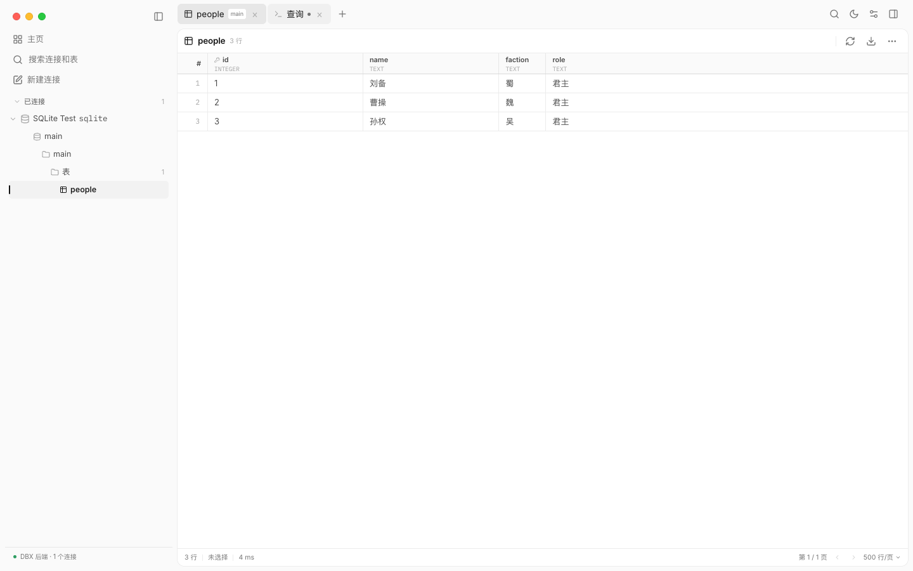
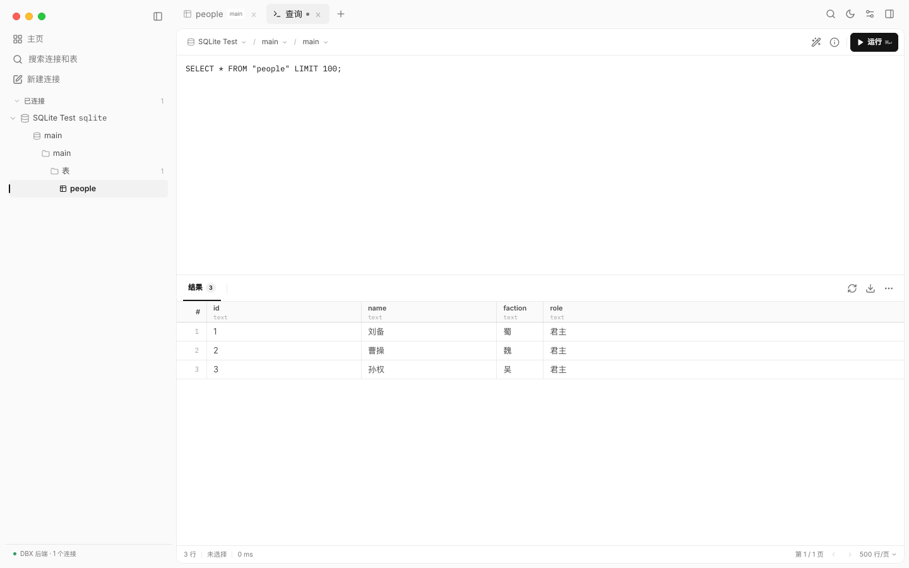

<div align="center">

# OMDBX · Cenuon fork

**自研 Electron + SolidJS 桌面界面，后端沿用上游 DBX（`dbx-web`）**

连接 → schema 树 → 表数据浏览 → SQL 查询，全部由真实 DBX 后端驱动。

[下载安装包](https://github.com/Cenuon/omdbx/releases) · [架构说明](apps/desktop-electron/ARCHITECTURE.md) · [发布流程](apps/desktop-electron/RELEASING.md) · [上游项目](https://github.com/t8y2/dbx)

</div>

---

> **这是 [`t8y2/dbx`](https://github.com/t8y2/dbx) 的个人 fork。**
> 后端保持上游 `crates/dbx-web` 不变，只把桌面前端换成自己设计的 Electron + SolidJS 界面，放在新增目录 `apps/desktop-electron/`。
> 上游发版时 `git fetch upstream && git merge upstream/main` 就能跟随升级，不用改上游业务代码。
>
> 应用名用 **OMDBX**：应用包名、数据目录、Linux 可执行名都和原版 DBX 完全错开，可以和原版同时安装。

## 截图

连接列表、schema 树与表数据浏览（真实 SQLite 数据）：



SQL 编辑器与查询结果：



## 这是什么

- **后端**：上游 DBX 的 Web 服务 `dbx-web`（Rust），以 sidecar 方式随应用启动，监听 `127.0.0.1` 随机端口。
- **前端**：本 fork 自研的 Electron + SolidJS 界面（`apps/desktop-electron/`）。
- **同源加载**：生产模式下 Electron 主进程把 `dbx-web` 的 `DBX_STATIC_DIR` 指向打包好的渲染层，页面与 `/api` 同源，不需要改上游 CORS。
- **数据来源**：界面显示的连接、库/schema、表、列、行都是 `dbx-web` 的真实返回，不再是静态演示数据。

上游 DBX 本身支持 MySQL / PostgreSQL / SQLite / Redis / MongoDB / DuckDB / SQL Server / 达梦 等大量数据库，完整的数据库与功能列表见 [上游 README](https://github.com/t8y2/dbx#readme)。本 fork 的安装包内置的 `dbx-web` 以 CI 的编译参数为准（见下文「从源码构建」）。

## 下载安装

到 [Releases](https://github.com/Cenuon/omdbx/releases) 下载对应平台：

| 平台 | 产物 |
| --- | --- |
| macOS（Apple Silicon / Intel） | `.dmg`、`.zip` |
| Windows x64 | NSIS 安装包、portable `.exe` |
| Linux x64 | `.AppImage`、`.deb` |

安装包**未签名**：

- macOS 首次打开需右键 → 打开（或先移除 quarantine 属性）。
- Windows 可能弹 SmartScreen 提示，选择「仍要运行」。
- Linux 下 AppImage 需 `chmod +x` 后运行。

## 已接通的功能

- 左侧连接列表：读取已保存的连接，显示类型标签与后端连接状态。
- 连接展开：连接数据库 → 读取 databases / schemas → 表列表。
- 表数据浏览：点击表执行 `SELECT * ... LIMIT 500`，按真实列渲染表头、类型与主键，显示行数与耗时。
- SQL 查询：编辑器输入 SQL 执行 `/api/query/execute`，结果按真实返回的列渲染。
- 明暗主题、侧栏/右栏折叠、窗口控制（最小化/最大化/关闭）。

## 仍是界面原型（未接后端）

- 右侧「AI 助手 / SQL 库 / 历史」面板目前是静态界面。
- 设置页、命令面板的部分条目、导出/筛选/排序按钮尚未接真实逻辑。

## 从源码运行与构建

需要 Node 22+ / pnpm 10+ / Rust 1.97+。

```bash
cd apps/desktop-electron

# 1. 编译 dbx-web 后端到 backend/（本机或 CI 各平台分别编译）
./scripts/build-backend.sh

# 2. 安装前端依赖
pnpm install --frozen-lockfile

# 3. 开发模式：终端 1 起后端，终端 2 起 Electron
pnpm dev:backend
pnpm dev

# 4. 打包当前平台安装包（产物在 release/）
pnpm dist:mac      # 或 dist:win / dist:linux
```

后端二进制不提交仓库（每平台 100 MB+），由 `scripts/build-backend.sh` 或 CI 编译。CI 用的编译命令：

```bash
cargo build --release -p dbx-web \
  --no-default-features \
  --features duckdb-sidecar,dynamodb,mq-admin,dbx-core/sqlite-bundled
```

打 tag 会触发四平台构建并把安装包附到 **draft** Release，发布流程见 [`apps/desktop-electron/RELEASING.md`](apps/desktop-electron/RELEASING.md)。

## 跟随上游升级

```bash
git remote add upstream https://github.com/t8y2/dbx.git   # 只需一次
git fetch upstream
git merge upstream/main
```

前端全部在 `apps/desktop-electron/`，后端与其余目录保持上游原样，因此合并冲突通常只可能出现在本 README。

## 目录结构

```
apps/desktop-electron/   本 fork 的 Electron + SolidJS 前端（新增）
  src/main/              主进程：启动 dbx-web sidecar、窗口
  src/renderer/          渲染层：界面 + dbx/client.ts（DBX HTTP 客户端）
  scripts/               后端编译 / 开发脚本
  backend/               本地编译的 dbx-web（不提交）
  docs/screenshots/      README 截图
  ARCHITECTURE.md        架构
  UPSTREAM.md            与上游的边界和升级方式
  RELEASING.md           发布流程
crates/dbx-web/          上游后端（不改动）
```

## 许可与致谢

本项目基于上游 DBX，遵循 [Apache-2.0](LICENSE)；上游的 `NOTICE` 一并保留。

- 上游项目：<https://github.com/t8y2/dbx>
- 上游文档与完整功能说明：<https://github.com/t8y2/dbx#readme>
