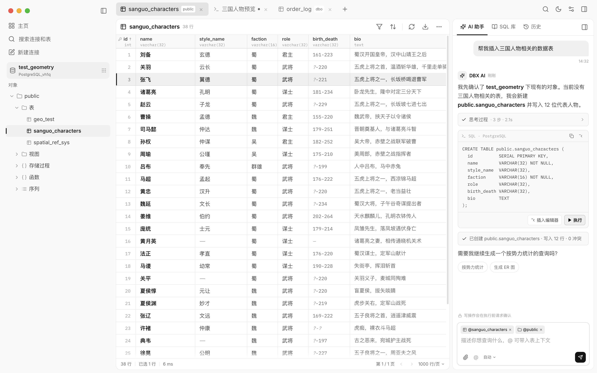

# OMDBX · Electron + SolidJS prototype

一个真正跑在 Electron 窗口里的 DBX 工作台原型。不是网页稿，窗口控制、标题栏拖拽、主题、面板收起都是桌面应用行为。

**这个目录位于 `Cenuon/dbx` fork 内**：DBX 后端使用上游的 `crates/dbx-web`，Electron 只做前端壳。架构和升级方式见：

- `ARCHITECTURE.md`
- `UPSTREAM.md`
- `backend/README.md`

v12 在 v11 基础上把 tab 内的上下内边距再收一点：顶栏仍是 44px，**tab 从 38px 收到 32px**，文字 13.5px 不变，选中背景 #e7e7e7。



## OpenCode 桌面端用的是什么

查了 `anomalyco/opencode` 当前 `dev`：

- **Electron 44**（主进程 + sidecar + IPC）
- **SolidJS + Vite**（`packages/app` 共享 UI，`packages/desktop` 做 Electron 壳）
- **Tailwind + `@opencode/ui`**（自己的组件库，Kobalte 作为 headless 基础）
- **Inter** 作为 UI 字体，**IBM Plex Mono** 作为代码字体
- 主题 token、0.5/1px 边框、分层阴影、150–200ms motion、自定义 titlebar

这个原型采用同一套**架构层**：Electron + SolidJS + Vite；视觉层按 OpenCode 的 token 思路重做（Inter / IBM Plex Mono、14px 基准、暖灰表面、hairline + 软阴影、右侧 extension rail）。没有直接吃 `@opencode/ui` 的整个组件库，避免把 OpenCode 的应用假设带进来。

## 运行

```bash
pnpm install

# 终端 1：DBX 后端
pnpm dev:backend

# 终端 2：Electron 前端
pnpm dev
```

如果 Electron 二进制下载失败，用镜像：

```bash
ELECTRON_MIRROR="https://npmmirror.com/mirrors/electron/" pnpm install
```

构建：

```bash
pnpm build
pnpm start
```

## 当前原型包含

- 左侧栏：顶部红黄绿 + 折叠按钮，下面 主页 / 搜索连接和表 / 新建连接，当前库 pill，对象树；无独立面板底色
- 折叠侧栏后，红黄绿和展开按钮回到主内容顶部 tabs 左侧（和 OpenCode 一致）
- 主内容顶部是全局标签栏：表格、查询、SQL 库标签，`+` 新建查询，右侧命令 / 主题 / 设置 / 右栏开关
- 中间数据表：30 行、字段类型、主键、选中行
- 查询标签：SQL 编辑器 + 结果表
- 右侧扩展面板：AI 助手 / SQL 库 / 历史，横向 tabs
- **没有底部状态栏**；行数 / 耗时留在表格底部，连接信息在左侧栏
- **设置页**：右上角设置图标打开；左侧设置导航 + 右侧偏好设置卡片；黑白 toggle、下拉项、时间表 slider；「返回应用」或点任意 tab 关闭
- `⌘K` 命令面板、toast、明暗主题、`⌘B` 侧栏收起
- 主图标统一 16px；树/标签等次级图标 12–13px；侧栏折叠和顶栏 panel toggle 都是 16px
- tab 不靠缩小字号变紧凑：44px 顶栏 + 32px tab，文字 13.5px；选中 tab 背景 #e7e7e7，左缘和工作台对齐
- tab 左缘和工作台面板左缘对齐；选中背景尽量填满 tab 栏
- Electron 窗口 IPC：最小化 / 最大化 / 关闭

## 下一步

两条路：

1. **保留 DBX 现有 Tauri + Vue**，把这套 Inter / 暖灰 token / 字号 / 行高 / 阴影 / 右侧扩展栏设计移植回去。成本最低，不重写业务。
2. **继续 Electron + SolidJS**，按 OpenCode 的技术栈重做 DBX 桌面端。视觉和桌面体验最接近，但等于前端重写，且和现有 Tauri 打包链分叉。

## 数据来源

左侧连接列表、schema 树、表数据浏览、SQL 查询都已接上游 `dbx-web` 的真实接口（见 `src/renderer/src/dbx/client.ts`），不再是静态数据。右侧 AI 助手 / SQL 库 / 历史面板和设置页仍是界面原型。
